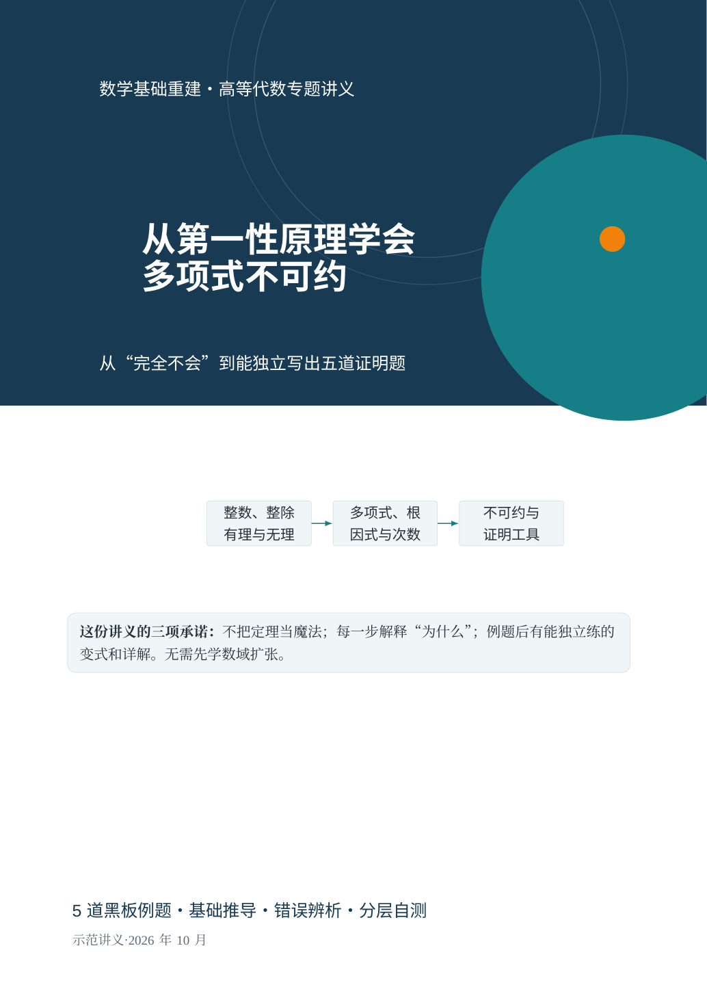
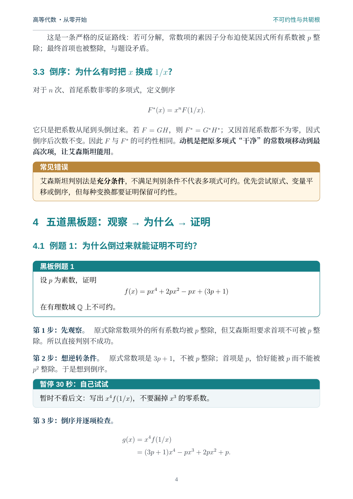

# First Principles Course PDF

**把一张题目照片，或一个学科章节，变成真正能从零学会的系统课程 PDF。**

[Agent Skills 规范](https://agentskills.io/specification)的可移植 Skill：不仅是提示词，还自带**可运行的 XeLaTeX 版式、课程脚手架、PDF 构建/质检程序，以及双模式完整示例**。



## 适用场景

- **基于题目：**「这是我的高等代数黑板题。把我当什么都不会，从整数、有理数、多项式定义讲起，把 5 题作为例题，编成 PDF。」
- **基于章节：**「帮我从第一性原理讲透《高等数学·导数的定义》，从函数和平均变化率讲起，最后做独立练习。」

同一套 Skill 还可用于大学物理、离散数学、概率论等有结构化知识依赖的课程。它负责**把课程写对、讲明白、做成一致风格的 PDF**；并不把零基础教学误解为堆砌公式或直接输出答案。

## 课程生产工作流

```text
题目/照片 ── 转录与核对 ── 考点/先修依赖分析 ──┐
                                               ├─> 概念动机/定义
科目/章节 ── 界定范围 ── 核心知识依赖图 ──────┘    │
                                                   ↓
从第一性原理推导 → 工具和反例 → 逐步例题/标准证法
                    ↓
            A/B/C 分层练习 + 详解 + 一页复盘
                    ↓
        固定 XeLaTeX 模板 → 两轮编译 → 全页渲染/审查
                    ↓
             A4 课程 PDF + 源码 + 预览
```

## PDF 视觉系统

严格沿用之前的 26 页高等代数讲义风格：A4 纵版，**深蓝/青绿封面与抽象圆形**，正文白底、青绿章节标题、细页眉页码、琥珀提醒框以及青绿题目框。版式母版在 `templates/course-style.sty`，各章仅改文字和内容，不改变设计变量。



原 PDF 视觉参照收录在 [assets/original-design-reference.pdf](assets/original-design-reference.pdf)；上述截图来自本仓库**新模板实际编译**的 PDF，并非效果图。

## 快速使用

### 1. 给 AI Agent 安装 Skill

将此仓库中的整个 `first-principles-course-pdf` 文件夹放进你的 Agent Skills 目录，或让支持 Agent Skills 的客户端安装该仓库。载入 `SKILL.md` 后，对 Agent 说：

> 使用 first-principles-course-pdf，把这些题做成零基础、从第一性原理讲起的课程 PDF，题目全部作为例题，补上先修知识和 A/B/C 分层练习，最后逐页检查。

技能规范见 `SKILL.md`；系统化教学设计见 `references/pedagogy.md`。

### 2. 本地准备运行环境

需要 **Python 3.9+、XeLaTeX、latexmk、CTeX/xeCJK、tcolorbox、Noto 中文字体**。

Ubuntu / Debian 参考：

```bash
sudo apt-get update
sudo apt-get install -y texlive-xetex texlive-lang-chinese texlive-latex-extra \
  latexmk fonts-noto-cjk poppler-utils
python -m pip install pymupdf pillow
```

macOS 可使用 MacTeX、Noto CJK 字体与 Python；Windows 可使用完整 TeX Live/MiKTeX 与 Noto CJK 字体。字体文件**不随此仓库分发**。

### 3. 两种入口

```bash
# 用题目驱动一门课
python scripts/new_course.py problems "多项式不可约" --subject 高等代数 --dir my-algebra

# 直接用科目章节生成课程脚手架
python scripts/new_course.py chapter "导数与微分" --subject 高等数学 --dir my-calculus
```

命令生成 `lesson.tex`、`course-brief.md`、`course.json`。前两项由 Agent 实际填写大纲、推导、原题与练习。**脚本不自动用 AI 伪造教学内容**：智能体需独立编写、校核正文。

### 4. 编译课程 PDF 并渲染所有页面

```bash
python scripts/build_course.py my-algebra/lesson.tex \
  --out my-algebra/course.pdf --preview my-algebra/preview

# 检查文字越界、字体、A4 页面尺寸等
python scripts/verify_pdf.py my-algebra/course.pdf
```

输出包含 `course.pdf`、`preview/pages/page-001.png` 等所有页面截图、`preview/contact-sheet.png` 和 `preview/qa-report.json`。请人工检查全部页面；通过软件的结构检查**不能**代替教学正确性审核。

## 两套已编译的示例

| 入口模式 | 题材 | 源码 | PDF |
|---|---|---|---|
| 题目驱动 | 高等代数：多项式不可约与五道黑板题 | [lesson.tex](examples/from-problems/lesson.tex) | [10 页 PDF](examples/from-problems/course.pdf) |
| 章节驱动 | 高等数学：从平均变化率到导数定义 | [lesson.tex](examples/from-chapter/lesson.tex) | [6 页 PDF](examples/from-chapter/course.pdf) |

复现两份示例：

```bash
python scripts/build_course.py examples/from-problems/lesson.tex --out /tmp/problems.pdf --preview /tmp/problems-preview
python scripts/build_course.py examples/from-chapter/lesson.tex --out /tmp/chapter.pdf --preview /tmp/chapter-preview
```

两种模式生成的 PDF **使用同一份 `.sty` 样式**；不是两个各自为政的设计。

## 文件组织

```text
first-principles-course-pdf/
├── SKILL.md                         # 标准 Skill 指令入口
├── README.md / LICENSE
├── templates/
│   ├── course-style.sty              # 固定 A4 版式系统
│   └── lesson.tex                    # 课程空白脚手架
├── references/
│   ├── pedagogy.md                   # 第一性原理教学规则
│   ├── design.md                     # 视觉设计规范
│   ├── latex-authoring.md            # 源码写法
│   └── qa.md                         # 教学正确性+视觉验收清单
├── scripts/
│   ├── new_course.py                 # 新建问题/章节课程
│   ├── build_course.py               # PDF 编译+渲染全部页面
│   ├── verify_pdf.py                 # PDF 结构质检
│   └── validate_skill.py             # Skill 元数据检查
├── examples/
│   ├── from-problems/                # 完整 5 题课程 PDF 和源码
│   └── from-chapter/                 # 完整导数章节 PDF 和源码
└── assets/                           # 实际预览和原版设计参考
```

## 质量承诺与限制

此 Skill 强制检查题面转录、前提、推导、反例和跨章依赖，并要求 XeLaTeX 两轮编译及逐页检查。`scripts/build_course.py` 会报告日志警告、空页、越界文字并渲染全页供审核，但**无法自动保证任意数学证明正确**；智能体应独立验证关键计算并说明有疑义的来源。

本项目基于 MIT License 开源。PDF 样式与内容可复用、改写；引用课本/图片请遵循其版权要求。不要通过该 Skill 生成可冒充官方教材的来源声明。
